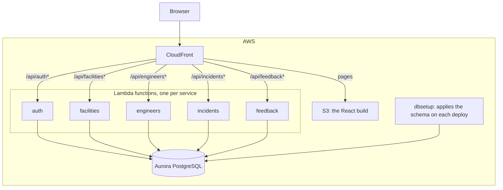
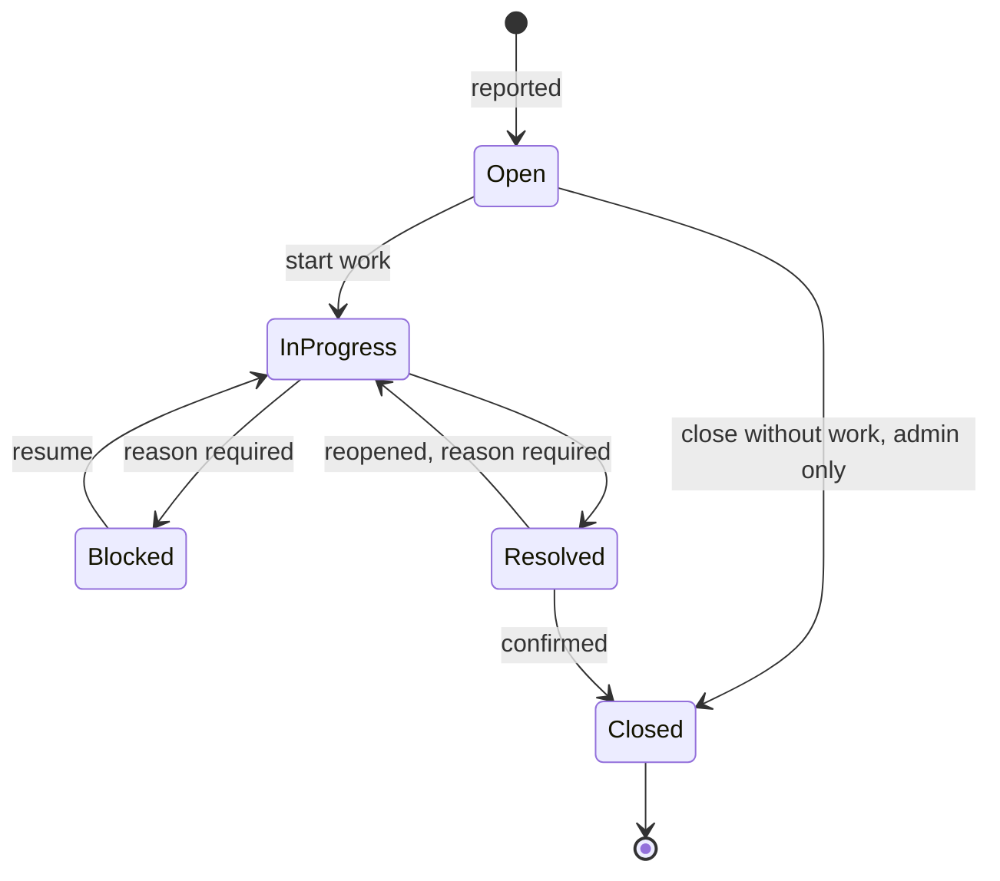

# ACME Facility Incident Management

A web application where ACME employees report problems with office facilities and workplace
technology, engineers work on them, and facility admins run the whole process. It was built
for the coding workshop in three days, on the workshop's stack: React with Material UI,
Python on AWS Lambda, and PostgreSQL.

- **Deployed site:** https://dpn10q5pgpe3g.cloudfront.net
- **Local site:** http://localhost:3000 after `./bin/start-dev.sh`
- **Longer write-up:** [docs/how-we-built-it.pdf](./docs/how-we-built-it.pdf), when present, explains every part in detail.

## Contents

1. [What it does](#what-it-does)
2. [Requirements and where each one stands](#requirements-and-where-each-one-stands)
3. [Architecture](#architecture)
4. [Run it locally](#run-it-locally)
5. [Deploy it to AWS](#deploy-it-to-aws)
6. [Run the feedback service in a container](#run-the-feedback-service-in-a-container)
7. [API reference](#api-reference)
8. [Roles and access rules](#roles-and-access-rules)
9. [The incident workflow](#the-incident-workflow)
10. [Data model](#data-model)
11. [Tests](#tests)
12. [Trade-offs and assumptions](#trade-offs-and-assumptions)
13. [Known gaps and future work](#known-gaps-and-future-work)

## What it does

| Persona | What they can do |
| --- | --- |
| **Employee** | Register with an `@acme.inc` address, report an incident against a building, floor and seat, follow its progress, add notes, correct the report until work starts, escalate it with a reason, confirm or reopen a fix, and rate the engineer's work |
| **Engineer** | See the incidents assigned to them, move them through the workflow, block one with a reason, and talk to the reporter through notes (with staff-only internal notes) |
| **Facility Admin** | Define buildings, floors and seats, create and manage engineer profiles, assign incidents and set priority, oversee every incident, and read the dashboards that answer the business questions |

Screens: sign in and register, a dashboard per role, the incident list with search and
filters, the report form, the incident page (workflow steps, history, notes, feedback),
Facilities, and Engineers.

## Requirements and where each one stands

The eight MVP capabilities from the workshop brief:

| # | Capability | Status | Where |
| --- | --- | --- | --- |
| 1 | User authentication and authorization | Met | `auth` service; sign-in, registration, token refresh, sign-out |
| 2 | Role-based access control | Met | Three roles, enforced by the API; menus and pages follow them |
| 3 | CRUD for incidents, facilities, engineer profiles and notes | Met | Every record can be created, read, changed and removed on screen |
| 4 | Incident workflow: Open, In progress, Blocked, Resolved, Closed | Met | Action buttons on the incident page; every move recorded |
| 5 | Visual representation of the ticket workflow | Met | Step view and history on the incident page |
| 6 | Dashboard and reporting per persona | Met | The home page, different for each role |
| 7 | Search and filter | Met | Incident list: search plus seven filters (six for an employee, who has no assignee filter), kept in the address |
| 8 | Responsive design for mobile and desktop | Met | Checked at 360, 768 and 1366 pixels wide |

The seven questions the business wanted answered, all on the admin dashboard unless noted:

| Question | Where the answer is |
| --- | --- |
| Which incidents are open, and what is their status? | Status tiles on every dashboard; the incident list |
| Which buildings, floors and seats have the most recurring issues? | "Where incidents recur" |
| How quickly are incidents acknowledged, assigned and resolved? | "Response times" |
| Which engineers are available, and how is work spread? | "Work across engineers"; the Engineers screen |
| Which facility and technology categories are most common? | "Most common categories" |
| Which incidents are escalated or blocked, and why? | "Needs attention"; reasons on each row of the list |
| How well are employees kept informed? | "Keeping reporters informed" |

Two requirements were added on the second day:

| Requirement | Status |
| --- | --- |
| The reporter can give feedback on the engineer, visible only to that engineer's manager | Met. No route returns feedback to the engineer, to other admins, or back to its author |
| Part of the solution runs in a container | Met locally: the feedback service runs on Kubernetes (minikube). The workshop AWS account has no permission for ECS, so on AWS the same code runs as a Lambda |

## Architecture



Locally the same pieces run on the workstation: Vite serves the frontend on port 3000, a
small proxy on port 3001 stands in for CloudFront, LocalStack runs the Lambdas, and
PostgreSQL runs on port 5432.

| Layer | Technology |
| --- | --- |
| Frontend | React 19, Material UI 9, React Router 7, React Responsive, Vite |
| Backend | Python 3.13 on AWS Lambda, one function per service, `psycopg` 3 |
| Database | PostgreSQL (Aurora Serverless v2 on AWS) |
| Infrastructure | Terraform, driven by the shell scripts in `bin/` |
| Tests | pytest against a real PostgreSQL; Vitest with Testing Library |

How the code is organised:

```text
backend/
  _shared/        database access, HTTP helpers, security: written once, copied into each service
  _db/            schema.sql (12 tables) and seed.sql (demo data)
  auth/           registration, sign-in, tokens
  facilities/     buildings, floors, seats
  engineers/      engineer profiles and their managers
  incidents/      incidents, the workflow, notes, dashboard numbers
  feedback/       feedback on engineers; also runs as a container (Dockerfile, k8s.yaml)
  dbsetup/        applies the schema (and the demo data on request) inside AWS
  tests/          one test file per service, plus the shared helpers
frontend/src/
  pages/          one file per screen, with its tests beside it
  components/     the layout and the pieces screens share
  services/       one file per backend service: the API calls
  utils/          form validation, date and place formatting, and the hooks the screens share
bin/              start, deploy and test scripts
infra/            Terraform
```

Each service is one `function.py` holding its endpoints and a route table. Everything the
services have in common lives in `backend/_shared`: one connection and transaction helper,
one request validator, one error shape, and one decorator that checks the role a route
needs. Rules about a single record (who may see, move or edit an incident, who is an
engineer's manager) sit beside the endpoint they protect.

## Run it locally

Prerequisites are installed by the workshop's `./bin/setup-environment.sh`: Node, Python
3.13, PostgreSQL, Docker, LocalStack and Terraform.

```sh
./bin/start-dev.sh
```

This starts PostgreSQL and LocalStack if needed, applies `backend/_db/schema.sql`, deploys
the Lambdas to LocalStack, and starts the proxy and the frontend. Open http://localhost:3000.

Load the demo data once, before anyone signs in (9 users, 3 engineers, 2 buildings, 12
incidents in every status):

```sh
PGPASSWORD=postgres123 psql -h localhost -U postgres -d postgres -f backend/_db/seed.sql
```

Every demo account uses the password `Password123`. One exception: if the app was used
before the demo data was loaded, the auth service has already created `admin@acme.inc` with
the local default password `Admin#12345`, and the demo data leaves that account's password
alone. The reset below avoids this.

| Role | Sign in as |
| --- | --- |
| Facility admin | `admin@acme.inc`, `morgan.admin@acme.inc` |
| Engineer | `priya.engineer@acme.inc`, `marco.engineer@acme.inc`, `lena.engineer@acme.inc` |
| Employee | `alice@acme.inc`, `bob@acme.inc`, `chen@acme.inc`, `dana@acme.inc` |

To put the local database back to the clean demo data at any time:

```sh
(echo "TRUNCATE users, buildings CASCADE;"; cat backend/_db/seed.sql) \
  | PGPASSWORD=postgres123 psql -h localhost -U postgres -d postgres -q
```

A new backend service appears locally after `./bin/start-dev.sh` is run again.

## Deploy it to AWS

```sh
./bin/deploy-backend.sh     # Terraform apply, then the schema is applied inside AWS
./bin/deploy-frontend.sh    # builds the frontend, uploads it, prints the CloudFront address
```

Both scripts fetch temporary workshop credentials themselves, using the workshop's
participant variables, which must already be set in the shell (see
[docs/validation.md](./docs/validation.md)). Two options on the first deploy:

- **Demo data:** `SEED_DEMO_DATA=true ./bin/deploy-backend.sh` also loads `seed.sql`. Safe to
  repeat: rows that exist are left alone.
- **Your own first admin, with no demo data:** type a password at a prompt so it is in no
  file in the repository and not in the shell history (it is held as a setting of the auth
  Lambda and in the Terraform state). The account is `admin@acme.inc`, created on the first
  request to the site:

  ```sh
  ( IFS= read -rsp 'Admin password: ' TF_VAR_seed_admin_password && export TF_VAR_seed_admin_password && ./bin/deploy-backend.sh )
  ```

The AWS database goes to sleep when idle. The first request after a quiet spell takes about
15 seconds while it wakes; the services wait for it.

## Run the feedback service in a container

The feedback service has a second way to run: as a container on Kubernetes. The business
code is the same `handler` the Lambda uses; `backend/feedback/server.py` is a small web
server in front of it, `Dockerfile` packages it, and `k8s.yaml` describes one pod with
health checks, a memory limit, a non-root user and the database password as a secret.

It needs minikube installed (the workshop setup script installs Docker and kubectl, not
minikube) and the local environment running, because the pod uses the workstation's
PostgreSQL.

```sh
./bin/deploy-minikube.sh         # start minikube if needed, build, deploy, point the local app at it
./bin/deploy-minikube.sh down    # send the local app back to the Lambda
```

To see it working:

```sh
minikube status
kubectl --context minikube get pods -l app=feedback       # 1/1 Running
curl http://$(minikube ip):30080/                          # {"service": "feedback", "status": "ok"}
kubectl --context minikube logs -f deploy/feedback         # the app's requests, among a health check (GET /) every few seconds
```

Run the script again after a restart of the machine or a change to the service's code. It
runs on the workstation only; the deployed site serves feedback from the Lambda.

## API reference

Every service is reached as `/api/<service>/...`. All routes need a signed-in user
(`Authorization: Bearer <access token>`) except health checks, registration, sign-in and
token refresh.

**auth**

| Method | Path | Does |
| --- | --- | --- |
| GET | `/api/auth` | Health |
| POST | `/api/auth/register` | Create an employee account (`@acme.inc` only) and sign in |
| POST | `/api/auth/login` | Exchange email and password for tokens |
| POST | `/api/auth/refresh` | Exchange a refresh token for a new pair |
| GET | `/api/auth/me` | The signed-in user |
| POST | `/api/auth/logout` | Revoke every token issued to the user |

**facilities** (reading: anyone signed in; changing: admin)

| Method | Path | Does |
| --- | --- | --- |
| GET | `/api/facilities` | Health |
| GET | `/api/facilities/buildings` | Every building with its floors and seats |
| POST | `/api/facilities/buildings` | Add a building |
| PATCH, DELETE | `/api/facilities/buildings/{id}` | Change or remove a building |
| POST | `/api/facilities/buildings/{id}/floors` | Add a floor |
| PATCH, DELETE | `/api/facilities/floors/{id}` | Change or remove a floor |
| POST | `/api/facilities/floors/{id}/seats` | Add a seat |
| PATCH, DELETE | `/api/facilities/seats/{id}` | Change or remove a seat |

**engineers** (admin only, except health)

| Method | Path | Does |
| --- | --- | --- |
| GET | `/api/engineers` | Health |
| GET | `/api/engineers/profiles` | Every engineer with their open-ticket count |
| POST | `/api/engineers/profiles` | Create an engineer: sign-in and profile together |
| PATCH, DELETE | `/api/engineers/profiles/{id}` | Change, deactivate or remove an engineer |
| GET | `/api/engineers/managers` | The admins who can be an engineer's manager |

**incidents**

| Method | Path | Does |
| --- | --- | --- |
| GET | `/api/incidents` | Health |
| GET | `/api/incidents/categories` | Categories for the report form |
| GET | `/api/incidents/tickets` | The incidents the caller may see. Filters: `status`, `priority`, `category_id`, `building_id`, `assignee` (`none`, `me` or a profile id), `escalated=true`, `open=true`, `q` |
| POST | `/api/incidents/tickets` | Report an incident |
| GET | `/api/incidents/tickets/{id}` | One incident with notes, history and the moves the caller may make |
| PATCH | `/api/incidents/tickets/{id}` | Set priority and assignee (admin) |
| PATCH | `/api/incidents/tickets/{id}/details` | Correct the title and description |
| DELETE | `/api/incidents/tickets/{id}` | Remove an incident (admin) |
| POST | `/api/incidents/tickets/{id}/status` | Move it along the workflow |
| POST | `/api/incidents/tickets/{id}/escalate` | Escalate it, with a reason |
| POST | `/api/incidents/tickets/{id}/notes` | Add a note |
| PATCH, DELETE | `/api/incidents/notes/{id}` | Change a note (its author) or remove it (its author or an admin) |
| GET | `/api/incidents/summary` | The dashboard numbers for the caller |

**feedback**

| Method | Path | Does |
| --- | --- | --- |
| GET | `/api/feedback` | Health |
| GET | `/api/feedback/incidents/{id}` | Whether the caller, as the reporter, can give feedback |
| POST | `/api/feedback/incidents/{id}` | Give a rating from 1 to 5 and an optional comment |
| GET | `/api/feedback/engineers` | Rating summary for each engineer the caller manages |
| GET | `/api/feedback/engineers/{id}` | The feedback on one engineer, for their manager only |

Status codes: 200 for a read or change, 201 for a creation, 204 for a removal or a sign-out,
400 for a validation error, 401 when not signed in, 403 when the role may not do it, 404
when the record does not exist or the caller may not see it, 405 when the path exists but
not with that method, 409 when the request clashes with the record's current state. Every
error has one shape; when a field is at fault, `details` names it (otherwise it is left out):

```json
{ "error": { "code": "validation_error", "message": "Some fields are invalid", "details": { "title": "Title is required" } } }
```

## Roles and access rules

- **Sign-in:** passwords are hashed with bcrypt. Sign-in returns a 15-minute access token and
  a 7-day refresh token; the frontend refreshes silently. Sign-out revokes every token issued
  to that user.
- **Three roles:** Employee, Engineer and Facility Admin. Registration always creates an
  employee; engineers are created by an admin.
- **Who sees which incident:** an admin sees all; an engineer sees those assigned to them and
  any they reported; an employee sees those they reported. An incident the caller may not see
  answers 404, the same as one that does not exist.
- **Checks live in the API.** The frontend hides what a role cannot do, but every rule is
  enforced on the server and covered by tests.
- **Feedback:** each engineer has a manager, one of the admins. Only that manager can read
  feedback about the engineer, and only the current manager can hand the engineer to another
  (an engineer with no active manager can be taken on by any admin).

## The incident workflow



- The assigned engineer and admins make these moves. The reporter can confirm a fix or reopen it.
- Work cannot start until an engineer is assigned; only an admin assigns.
- Every move is saved together with a history row (who, when, why), and only if nobody else
  moved the incident in the meantime.
- The incident page shows the moves the viewer is allowed to make and nothing else.

## Data model

Twelve tables, all in [backend/_db/schema.sql](./backend/_db/schema.sql), which is safe to
apply repeatedly:

| Table | Holds |
| --- | --- |
| `users` | Accounts, with role and password hash |
| `engineer_profiles` | Specialism, availability, capacity and manager of each engineer |
| `buildings`, `floors`, `seats` | The places an incident can be reported against |
| `categories` | Facility and technology categories |
| `incidents` | The tickets: status, priority, location, reporter, assignee, timestamps |
| `incident_status_history` | Every move through the workflow |
| `incident_notes` | Notes, public or internal |
| `incident_feedback` | One rating and comment per incident, about the engineer |
| `app_secrets` | The token signing key, shared by all services |
| `ai_suggestions` | Reserved for a future feature; no service reads or writes it (the demo data holds two sample rows) |

Rules that matter are in the database as well as the code: a floor must belong to the
chosen building, a blocked incident must have a reason, and anything an incident points at
cannot be deleted.

## Tests

| Suite | Command | Result on 19 November 2026 |
| --- | --- | --- |
| Backend | `./bin/test-backend.sh` | 793 tests pass; 100% line and branch coverage |
| Frontend | `cd frontend && npm run coverage` | 389 tests pass in 23 files; 99.8% of statements and 98.6% of branches covered |
| Frontend lint | `cd frontend && npm run lint` | Clean |

- **Backend tests** call each service's handler with real requests against a real
  PostgreSQL, in a throwaway schema created for the run. They cover every endpoint, every
  role on every route, each validation message, each workflow move for each kind of person,
  and that a failure never leaves half-saved data.
- **Frontend tests** render each screen against a fake API and assert what a person sees and
  the exact requests sent, including error states and loading states.
- **Review:** each step was read by independent reviewers, and a second reviewer tried to
  disprove every finding before anything was changed. A final pass exercised every MVP
  capability in a real browser (Firefox) against the running app, at phone, tablet and
  laptop widths; its confirmed findings were fixed.
- **Manual check of the deployed site:** each service's health, sign-in for each role, the
  incident list with filters and the dashboard numbers were checked through the public address.

Not covered: there are no automated end-to-end browser tests in the repository (the browser
pass above was run by hand-written scripts that are not checked in), and there is no load
test. Both are future work.

## Trade-offs and assumptions

- **One Lambda per service, shared code copied in.** Lambdas package one folder each, so the
  shared modules live once in `backend/_shared` and a script copies them into each service.
  This keeps one source of truth without a build system.
- **No web framework on the backend.** A small routing and validation helper is enough for
  this size, keeps cold starts short and the packages small.
- **Sessions are tokens, not server state.** Lambdas keep nothing between requests. Sign-out
  works by bumping a version number on the user, which every request checks.
- **The whole list is reloaded after each change** on the admin screens. It is simple and
  always shows what the server holds; it would need paging for large data.
- **The facility admin is the engineer's manager.** The brief has three personas, so the
  "manager" who reads feedback is one of the admins, linked on the engineer's profile.
- **Only admins assign incidents.** Engineers do not pick up unassigned work.
- **The reporter can correct a report until work starts** (an admin until it is closed);
  after that, changes belong in notes so the engineer is not working from a moving description.
- **Search uses `ILIKE`,** which reads every visible row. That is fast at this size; a
  trigram index would be the next step for large data.
- **Demo accounts share one password** and are for demonstration only (see the note about
  `admin@acme.inc` under "Run it locally").

## Known gaps and future work

- No end-to-end test suite in the repository, and no load testing.
- Employees are not notified when something changes; they see it when they open the incident.
- No password change or reset, and no screen to create another admin (the demo data has two).
- Signing out ends that account's sessions in every browser.
- Duplicate incidents are not detected or linked by the app (the schema has a column for it,
  which the demo data fills for one incident, but no screen or route uses it).
- An escalation cannot be undone, and the history does not record assignments or escalations.
- The incident list returns at most 200 incidents and has no paging.
- The container runs on a local Kubernetes only; a registry and ECS Fargate or managed
  Kubernetes would be the next step when the account allows it.
- Real-time updates, offline support and AI suggestions are not built.

## About the workshop template

This repository started from the workshop's participant template. The workshop's own guides
are in [docs/](./docs/README.md); see also [CONTRIBUTING](./CONTRIBUTING.md) and the
[LICENSE](./LICENSE) (MIT-0).
